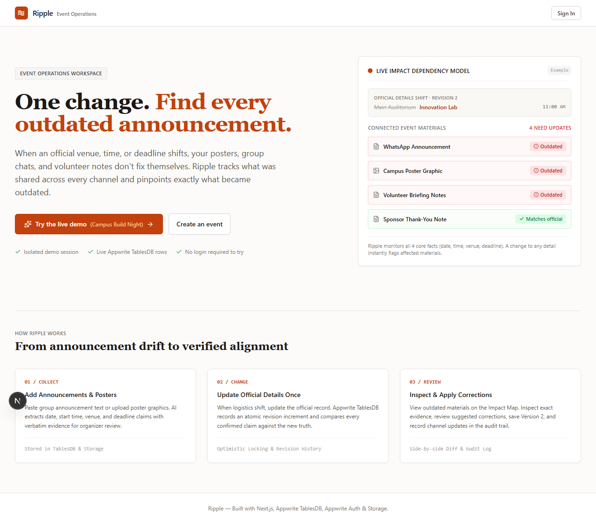
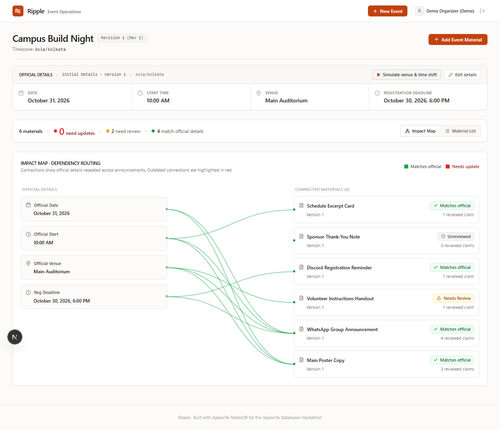
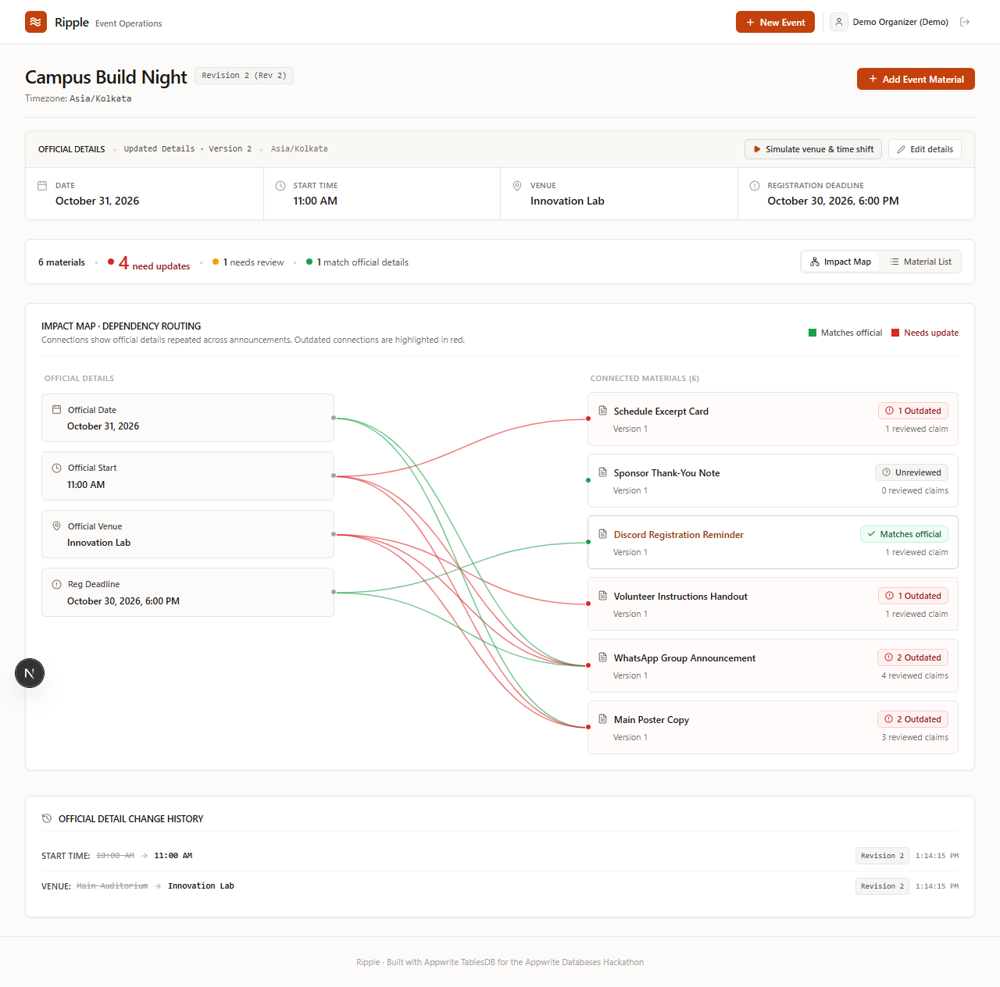
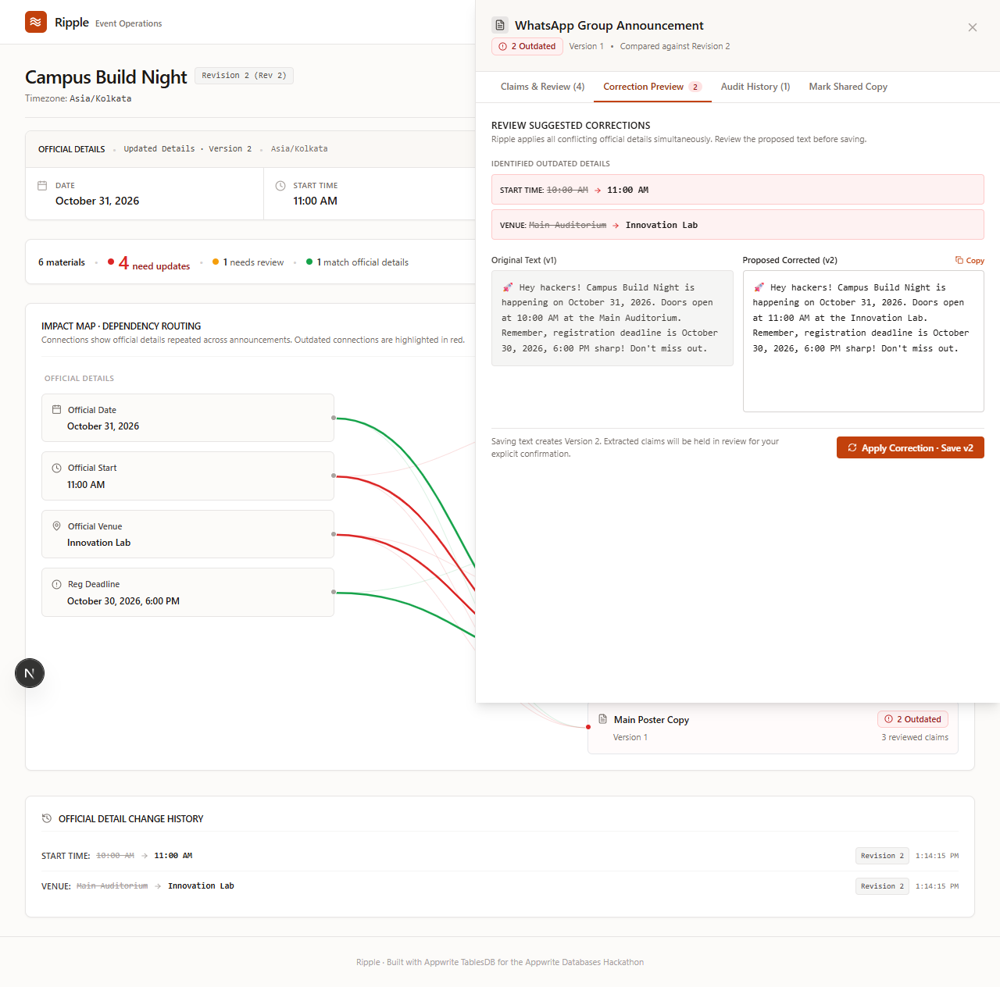
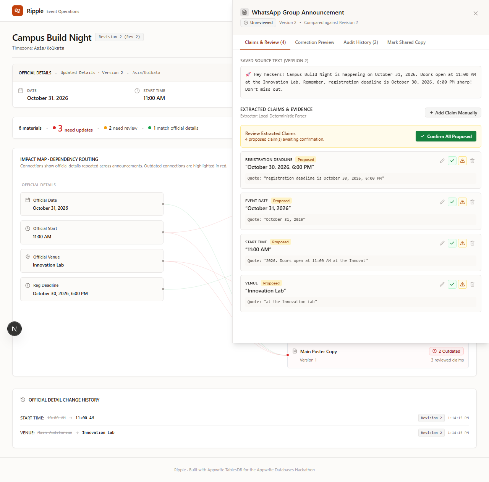
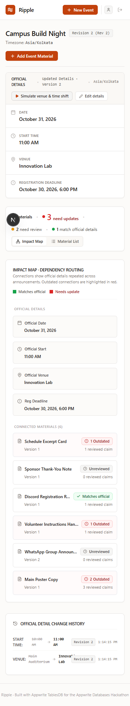
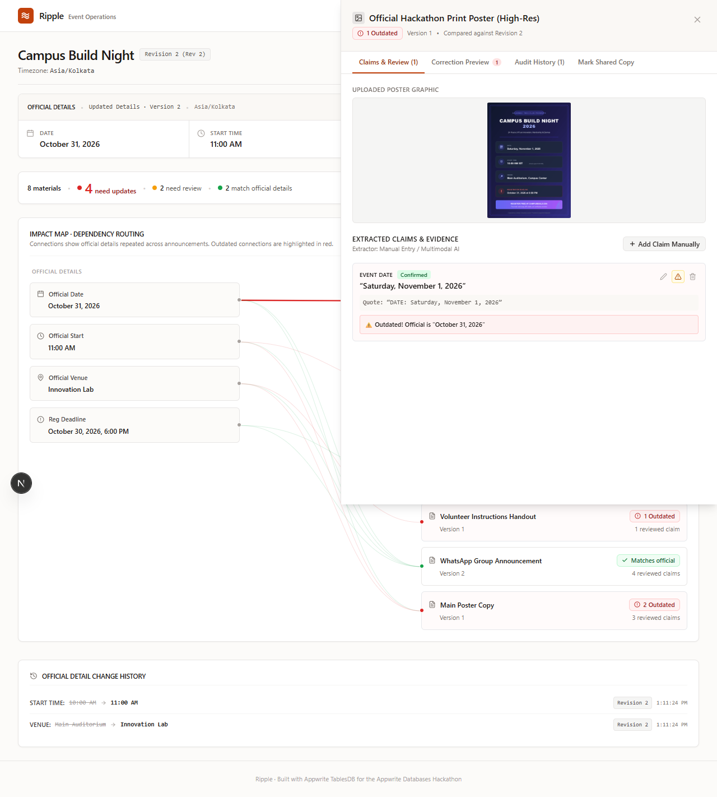
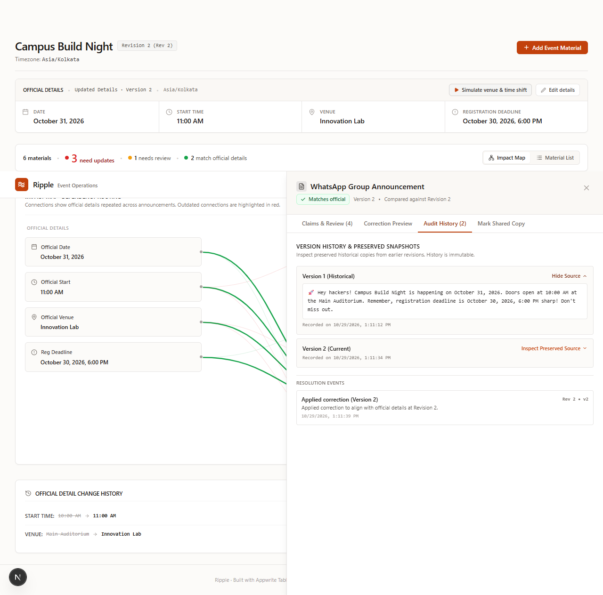
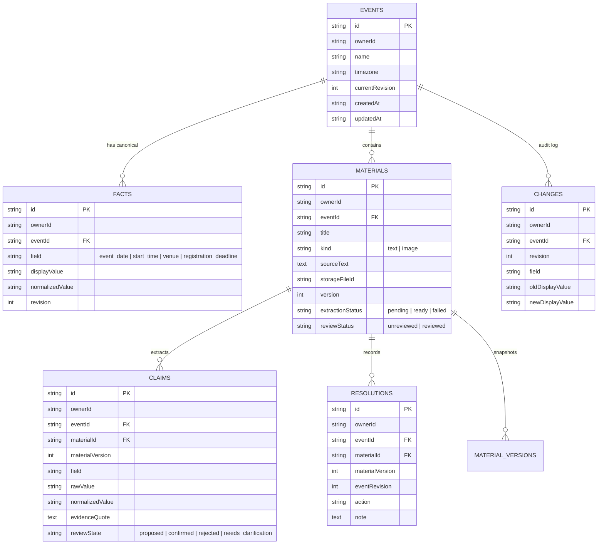

# Ripple

> **“Your venue changed. Your poster and volunteer instructions didn't. Ripple finds what needs fixing.”**

Ripple is a production-grade web application built for the **Appwrite Databases Hackathon**. It helps college club organizers detect, visualize, and fix outdated event information across announcements, social copy, posters, and volunteer instructions whenever an official detail changes.

- **Live Public Demo**: [https://ripple-hackathon.vercel.app](https://ripple-hackathon.vercel.app) *(Deploy via Vercel)*
- **Demo Scenario**: Campus Build Night (Pre-seeded with 6 materials and 1-click official detail shift)

---

## 📸 Interface & Workflow Walkthrough

| 1. Editorial Landing Page | 2. Initial Workspace & Impact Map |
| :---: | :---: |
|  |  |
| *Composed opening with dependency model and 3-step walkthrough.* | *Official details strip, compact status counter & Impact Map.* |

| 3. Real-Time Outdated Detection (Revision 2) | 4. Side-by-Side Correction Inspector |
| :---: | :---: |
|  |  |
| *Visual dependency map highlights outdated announcements.* | *Diff comparison highlighting exact changes before saving Version 2.* |

| 5. Explicit Claims Review & Evidence Validation | 6. Mobile Responsive Workspace |
| :---: | :---: |
|  |  |
| *Proposed claims banner requires explicit confirmation.* | *Default list mode and compact layout for mobile organizers.* |

| 7. Poster Upload & Manual Review | 8. Preserved Version Audit Trail |
| :---: | :---: |
|  |  |
| *Appwrite Storage upload with manual claim entry & review.* | *Full audit trail preserving historical source snapshots.* |

---

## 🎯 Target User & Core Workflow

- **Target User**: A college club organizer managing announcements, posters, and volunteer briefings for a campus event.
- **Official Tracked Fields**:
  1. `event_date` (ISO calendar date)
  2. `start_time` (24-hour / 12-hour attendee start time)
  3. `venue` (Normalized building / hall name)
  4. `registration_deadline` (Explicit cutoff date & time)
  - Explicit **Event Timezone** (e.g., `Asia/Kolkata`) guarantees unambiguous scheduling.

### The 7-Step Lifecycle:
1. **Create an Event**: Define official event details and timezone in Appwrite TablesDB.
2. **Register Materials**: Paste plain-text announcements or upload poster graphics (PNG/JPEG).
3. **Claim Extraction**: Server-side extraction parses dates, times, venues, and deadlines with verbatim evidence quotes.
4. **Explicit Organizer Review**: Extracted claims start in a `proposed` (or `needs_clarification`) state. The organizer explicitly reviews, edits, or confirms them.
5. **Relational Comparison Engine**: Ripple compares confirmed claims against official details.
6. **Instant Conflict Impact Map**: When official details change, outdated materials visibly highlight with conflict counts and exact evidence diffs.
7. **Resolution, Versioning & Audit**: Apply unified text corrections (bumping to Version $N+1$), confirm newly extracted claims, and preserve historical source snapshots.

---

## 💡 Meaningful Use of Appwrite TablesDB

Ripple is architected from first principles around **Appwrite TablesDB** and Appwrite Storage:



1. **Atomic Multi-Row Transactions**:
   Official detail modifications (e.g. changing Venue $\rightarrow$ `Innovation Lab` and Start Time $\rightarrow$ `11:00 AM`) execute via Appwrite TablesDB transactions (`createTransaction`, `createRow`, `updateRow`, `updateTransaction`). The updated facts, revision increment, and change-history audit rows commit together atomically. If an operation fails, the transaction rolls back cleanly.
2. **Optimistic Concurrency Control**:
   Updates check `expectedRevision` against `event.currentRevision`. Concurrent edits against the same revision trigger a 409 conflict, preventing stale overwrites and duplicate revision history.
3. **Relational Claim-to-Fact Dependency Graph**:
   Conflict states are not flat boolean flags. They are dynamically evaluated relations between canonical `facts` and material `claims`. Changing one fact updates only the materials dependent on that specific fact.
4. **Strict Row & Storage Security**:
   Every row and storage file enforces owner-specific access (`Permission.read(Role.user(userId))`, `Permission.update(Role.user(userId))`). Even demo visitors receive isolated authenticated sessions, guaranteeing complete multi-tenant separation.

---

## 🔍 Explicit Claim Review & Complete Claim Validation

To eliminate false verifications, Ripple enforces strict database and comparison rules:

- **Explicit Organizer Review**: When a new version is created from corrected text, newly extracted claims are saved as `proposed` (or `needs_clarification`). They require explicit organizer confirmation before the material can become `Reviewed · Matches official details`.
- **Complete Claim Validation**: A verbatim evidence quote is necessary but not sufficient. Server-side validation asserts:
  1. The evidence quote occurs verbatim in the saved source copy.
  2. The evidence quote **supports** the claimed value (the quote contains the claimed text). For example, quote `"Venue: Main Auditorium"` with claimed venue `"Innovation Lab"` is rejected by the server and flagged as an unsupported conflict.
  3. The field classification is valid (e.g. a time cannot be classified as a venue).
  4. Synthetic quotes (`"Updated in v..."`) are strictly forbidden.
- **Image Review Preservation**: When `sourceText` is absent on image materials, text substring checks are bypassed so organizers can inspect uploaded graphics and explicitly confirm claims without false rejections.
- **Audit Preservation**: Historical source snapshots are preserved across versions, allowing organizers to expand and inspect past version text in the Audit History tab.

---

## 🤖 AI Capabilities & Accurate Boundaries

- **Supported AI Provider**: Ripple's AI client connects to any **OpenAI-compatible Chat Completions API** (`https://api.openai.com/v1` or compatible proxy) using multimodal models (e.g. `gpt-4o-mini`).
- **Notice on Gemini / Other Providers**: Ripple does not include a native Gemini SDK implementation. We do not claim Gemini compatibility.
- **Zero-Disruption Fallback**:
  - If `AI_API_KEY` is omitted or unavailable, Ripple's built-in **deterministic local regex/context parser** automatically extracts text claims with zero downtime.
  - For image posters, the interface clearly displays *Unverified (AI Extraction Unavailable)* and provides an explicit manual claim entry interface. Storage upload to Appwrite is never falsely represented as OCR verification.

---

## 🛠️ Stack & Libraries Used

- **Framework**: [Next.js 16.4.3](https://nextjs.org/) (App Router, Turbopack, Server Components & Route Handlers)
- **Language**: [TypeScript 7.0](https://www.typescriptlang.org/) (Strict typing, `allowImportingTsExtensions`)
- **Backend & Database**: [Appwrite TablesDB](https://appwrite.io/docs/products/databases/tables) (`node-appwrite` v31.1.0)
- **Authentication**: [Appwrite Auth](https://appwrite.io/docs/products/auth) (Cookie-backed sessions, anonymous demo users, email/password registration)
- **File Storage**: [Appwrite Storage](https://appwrite.io/docs/products/storage) (Private bucket for high-res posters)
- **Styling**: [Tailwind CSS 3.4](https://tailwindcss.com/)
- **Icons**: [Lucide React 1.63](https://lucide.dev/)
- **Validation**: [Zod 4.6](https://zod.dev/)
- **E2E Automation**: [Puppeteer Core 25.16](https://pptr.dev/)

---

## 🚀 Local Development Setup

### 1. Clone & Install
```bash
git clone <repository-url>
cd "appwrite database hackathon"
npm install
```

### 2. Configure Environment (`.env.local`)
Copy `.env.example` to `.env.local`:
```bash
cp .env.example .env.local
```

Configure your Appwrite Cloud project settings:
```env
NEXT_PUBLIC_APPWRITE_ENDPOINT="https://sgp.cloud.appwrite.io/v1"
NEXT_PUBLIC_APPWRITE_PROJECT_ID="your-project-id"
APPWRITE_API_KEY="your-server-api-key"
APPWRITE_DATABASE_ID="ripple_db"
APPWRITE_STORAGE_BUCKET_ID="ripple_materials"
SESSION_COOKIE_NAME="ripple_session"

# Optional: Multimodal AI key (if omitted, local parser & manual review take over)
AI_API_KEY=""
AI_MODEL="gpt-4o-mini"
AI_BASE_URL="https://api.openai.com/v1"
```

### 3. Provision Appwrite TablesDB & Storage Bucket
Run the automated, idempotent setup script to create all 6 tables and the storage bucket:
```bash
node scripts/setup-appwrite.mjs
```

### 4. Run Development Server
```bash
npm run dev
```
Open [http://localhost:3000](http://localhost:3000) in your browser.

### 5. Run Test Suites
```bash
# Core Comparison & Normalization Tests (12 tests)
node test/comparison.test.mjs

# Sample Event Fixture & Concurrency Tests (4 tests)
node test/sample_event_regression.test.mjs

# Multi-tenant Authorization Tests (3 tests)
node test/authorization.test.mjs

# Claim Integrity & Correction Regression Tests (8 tests)
node test/correction_and_extraction_regression.test.mjs

# Live Appwrite Integration Gap Verification
node scripts/verify-integration-gaps.mjs

# End-to-End Browser Automation
node scripts/verify-browser-workflow.mjs
```

### 6. Production Build
```bash
npm run build
```

---

## 🌐 Vercel Deployment Instructions

### Step 1: Create a GitHub Repository & Push
If you haven't connected a Git remote yet:
```bash
# Create a new public repository on GitHub (e.g. ripple-hackathon)
git remote add origin https://github.com/<your-username>/ripple-hackathon.git
git branch -M main
git push -u origin main
```
*(Note: `.env.local` is ignored and will never be committed).*

### Step 2: Import into Vercel
1. Log in to your [Vercel Dashboard](https://vercel.com).
2. Click **Add New...** $\rightarrow$ **Project**.
3. Import your `ripple-hackathon` GitHub repository.
4. Framework Preset will automatically detect **Next.js**.

### Step 3: Configure Environment Variables in Vercel
In the **Environment Variables** section, enter:

| Variable Name | Value |
| :--- | :--- |
| `NEXT_PUBLIC_APPWRITE_ENDPOINT` | `https://sgp.cloud.appwrite.io/v1` *(or your Appwrite endpoint)* |
| `NEXT_PUBLIC_APPWRITE_PROJECT_ID` | Your Appwrite project ID |
| `APPWRITE_API_KEY` | Your Appwrite Server API Key |
| `APPWRITE_DATABASE_ID` | `ripple_db` |
| `APPWRITE_STORAGE_BUCKET_ID` | `ripple_materials` |
| `SESSION_COOKIE_NAME` | `ripple_session` |
| `AI_API_KEY` | *(Optional)* OpenAI API key (leave blank to use local parser) |
| `AI_MODEL` | `gpt-4o-mini` |
| `AI_BASE_URL` | `https://api.openai.com/v1` |

Click **Deploy**.

### Step 4: Register Production Hostname in Appwrite
Once Vercel assigns your production domain (e.g., `ripple-hackathon.vercel.app`):
1. Open the **Appwrite Console**.
2. Navigate to **Project Settings** $\rightarrow$ **Platforms**.
3. Click **Add Platform** $\rightarrow$ **Web App**.
4. Set **Name** to `Ripple Production` and **Hostname** to your Vercel domain (e.g. `ripple-hackathon.vercel.app`).
5. Save. Your production deployment is now fully authorized!

---

## 🎬 2–3 Minute Submission Video Script

**Title**: *Ripple — Solving Event Outdated Information with Appwrite TablesDB*  
**Presenter**: Organizer / Lead Developer

### [0:00 – 0:35] The Problem & Landing Page
- **Visual**: Open the live application on the home page.
- **Spoken**:  
  > *"Every college club organizer knows this pain: your facility manager emails you 24 hours before your hackathon saying the auditorium is double-booked. You update the venue, but did you remember to update the Instagram story? The Discord announcement? The volunteer instructions handout?  
  > Usually, outdated information slips through. Ripple solves this. Pitch: 'Your venue changed. Your poster and volunteer instructions didn't. Ripple finds what needs fixing.'"*

### [0:35 – 1:15] Launching the Workspace & The Relational Dependency Graph
- **Visual**: Click **"Try Sample Event: Campus Build Night"**. The event workspace opens at Revision 1.
- **Spoken**:  
  > *"In one click, Ripple provisions an isolated session in Appwrite TablesDB and seeds 'Campus Build Night'.  
  > Across the top, you see the official canonical facts: October 31, 2026, 10:00 AM, Main Auditorium, and October 30 deadline.  
  > Below is our Impact Map. Ripple doesn't use flat drift flags. Instead, every material—from our main poster copy to volunteer instructions—has extracted claims linked relationally in TablesDB to these canonical facts.  
  > Notice material #3: Volunteer Instructions mentions '8:30 AM arrival'. Ripple accurately flags this with 'needs clarification' rather than falsely assuming it is the public attendee start time."*

### [1:15 – 1:55] Simulating the Official Change & Appwrite Transactions
- **Visual**: Click **"Simulate Official Change"**. The modal displays: Venue $\rightarrow$ Innovation Lab, Start Time $\rightarrow$ 11:00 AM. Click **"Confirm & Commit Demo Change"**.
- **Spoken**:  
  > *"Now, the venue is reassigned to Innovation Lab and start time is delayed to 11:00 AM. Let's commit the change.  
  > Under the hood, Appwrite TablesDB executes an atomic multi-row transaction: updating the facts, incrementing the revision to Rev 2, and logging the change history.  
  > Instantly, the Impact Map recalculates: 4 materials light up in red as Outdated. But look at material #4, the Registration Reminder: it stays green because its deadline fact was unchanged."*

### [1:55 – 2:35] Side-by-Side Correction, Complete Claim Validation & Explicit Review
- **Visual**: Open **WhatsApp Group Announcement** card. Navigate to **Correction Preview**. Show the suggested text with both 11:00 AM and Innovation Lab. Click **"Apply Correction"**. Switch to **Claims & Review** tab. Show proposed claims. Click **"Confirm All Proposed"**. Material updates to `Verified Current`.
- **Spoken**:  
  > *"Let's fix the WhatsApp announcement. Ripple's correction engine applies all conflicting facts simultaneously, updating the time to 11:00 AM and venue to Innovation Lab, while removing the obsolete auditorium.  
  > When we apply this correction, Ripple writes Version 2 to Appwrite TablesDB. Newly extracted claims are held in a 'proposed' state—we never auto-confirm them.  
  > Furthermore, Ripple enforces complete claim validation: every confirmed claim must be supported verbatim by the saved source text. If a quote doesn't support the claimed value, it is rejected.  
  > We review and click 'Confirm All Proposed'. The material immediately updates to Verified Current."*

### [2:35 – 3:00] Audit History, Image Upload & Conclusion
- **Visual**: Switch to the **Audit History** tab. Expand **"Inspect Preserved Source"** to show historical Version 1 text with Main Auditorium. Briefly show the high-res poster upload with manual review.
- **Spoken**:  
  > *"In the Audit History tab, Version 1's historical source is preserved permanently for accountability. And for poster images uploaded to Appwrite Storage, organizers can conduct manual claim review with full confidence.  
  > Ripple turns chaotic last-minute changes into verified, database-backed clarity. Built with Next.js, TypeScript, and Appwrite TablesDB."*

---

## 📜 License
MIT License. Built for the **Appwrite Databases Hackathon**.
