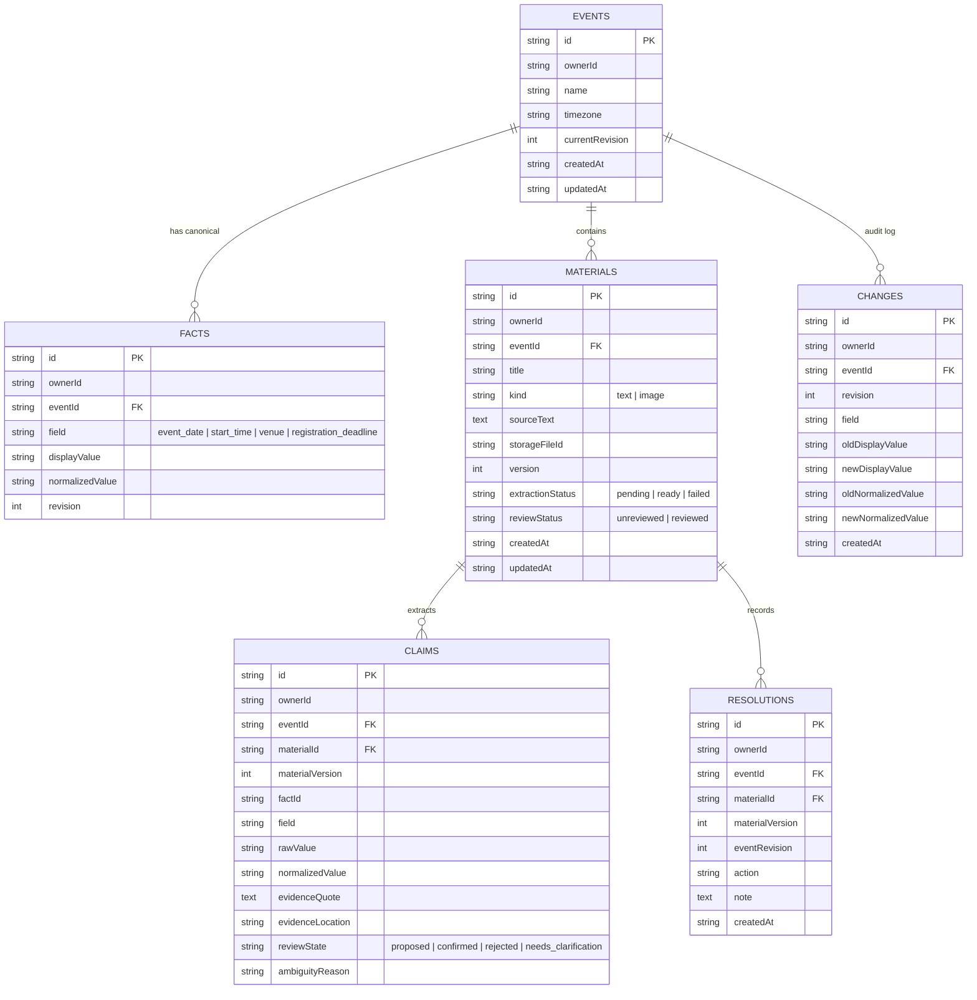

# Ripple

> **“Your venue changed. Your poster and volunteer instructions didn't. Ripple finds what needs fixing.”**

Ripple is a polished web application built for the **Appwrite Databases Hackathon**. It helps college club organizers detect, visualize, and fix outdated event information across announcements, social copy, posters, and volunteer instructions whenever an official detail changes.

---

## 🎯 Target User & Core Workflow

- **Target User**: A college club organizer managing announcements, posters, and volunteer instructions for an event.
- **Official Canonical Fields Tracked**:
  1. `event_date` (ISO calendar date)
  2. `start_time` (Local time in event timezone)
  3. `venue` (Normalized building / hall name)
  4. `registration_deadline` (Explicit datetime in event timezone)
  - Plus an explicit **Event Timezone** (e.g. `Asia/Kolkata`) so dates and times remain unambiguous.

### Core Workflow:
1. **Create an Event**: Enter official canonical facts and timezone.
2. **Add Materials**: Paste plain-text announcements or upload poster screenshots (PNG/JPEG).
3. **AI Extraction**: Multimodal server-side AI extracts relevant claims with supporting verbatim quotes.
4. **Organizer Review**: Organizer confirms, edits, or marks ambiguous claims (e.g., distinguishing volunteer arrival from event start).
5. **Comparison Engine**: Ripple compares confirmed claims against canonical facts.
6. **Official Detail Changes**: When venue or time changes, affected materials instantly highlight as **Outdated** on an interactive **Impact Map**.
7. **Resolution & Versioning**: Review side-by-side suggested corrections, apply them to produce Version $N+1$, and record external channel updates in the audit trail.

---

## 💡 Why Appwrite TablesDB is Essential

Ripple is built from the ground up around **Appwrite TablesDB** as its sole application database:

1. **Relational Dependency Graph**:
   Ripple does not maintain flat, drifting status flags. Instead, it stores the relational dependency between an official fact and every material claim that repeats it. Conflict states are dynamically derived from real database relationships.
2. **Atomic Multi-Row Transactions**:
   When an organizer modifies official details (e.g., changing both Venue and Start Time), Appwrite TablesDB transactions (`createTransaction`, `createRow`, `updateRow`, `updateTransaction`) ensure that fact updates, event revision increments, and change-history audit rows commit atomically. If any part fails, the entire transaction rolls back.
3. **Optimistic Concurrency Control**:
   Edits verify `expectedRevision` against `event.currentRevision`. Stale browser tabs cannot silently overwrite newer revisions.
4. **Strict Row & Storage Permissions**:
   Every row and uploaded image is tagged with `ownerId` and scoped with Appwrite user permissions (`Permission.read(Role.user(userId))`, `Permission.update(Role.user(userId))`). Even demo visitors get isolated anonymous sessions, preventing shared writable data leaks.

---

## 🗄️ Database Architecture & Diagram

Ripple defines 6 explicit tables in Appwrite TablesDB:



---

## 🚀 Quickstart & Setup

### Prerequisites
- Node.js 20+ (Node 24 recommended)
- An Appwrite project (Appwrite Cloud at `https://cloud.appwrite.io/v1` or self-hosted)

### 1. Clone & Install Dependencies
```bash
git clone <repo-url>
cd "appwrite database hackathon"
npm install
```

### 2. Configure Environment Variables
Copy `.env.example` to `.env.local`:
```bash
cp .env.example .env.local
```

Fill in your Appwrite and AI credentials:
```env
NEXT_PUBLIC_APPWRITE_ENDPOINT="https://cloud.appwrite.io/v1"
NEXT_PUBLIC_APPWRITE_PROJECT_ID="your-project-id"
APPWRITE_API_KEY="your-server-api-key"
APPWRITE_DATABASE_ID="ripple_db"
APPWRITE_STORAGE_BUCKET_ID="ripple_materials"

# AI Multimodal extraction (OpenAI or compatible endpoint)
AI_API_KEY="your-openai-api-key"
AI_MODEL="gpt-4o-mini"
```

> **Note**: If `AI_API_KEY` is not provided, Ripple's built-in rule-based extractor and manual claim entry flow automatically take over with zero disruption.

### 3. Provision Appwrite TablesDB & Storage Bucket
Run the automated idempotent provisioning script:
```bash
node scripts/setup-appwrite.mjs
```
This script automatically creates:
- The `ripple_db` database
- All 6 tables (`events`, `facts`, `materials`, `claims`, `changes`, `resolutions`) with attributes
- The `ripple_materials` storage bucket for uploaded posters (PNG/JPEG)

### 4. Run Development Server
```bash
npm run dev
```
Open [http://localhost:3000](http://localhost:3000) in your browser.

### 5. Run Domain Tests
```bash
npm test
```
Runs 12 focused unit tests covering date/time normalization, venue whitespace collapse without fuzzy matching, ambiguous claim flagging, timezone handling, multiple conflicts, stale suggestion detection, and version audit preservation.

### 6. Production Build
```bash
npm run build
```

---

## 🎪 Fictional Sample Event: "Campus Build Night"

Ripple includes a pre-seeded, isolated sample event: **Campus Build Night**.

### Initial Canonical Details (Revision 1):
- **Event Date**: October 31, 2026
- **Start Time**: 10:00 AM
- **Timezone**: `Asia/Kolkata`
- **Venue**: Main Auditorium
- **Registration Deadline**: October 30, 2026, 6:00 PM

### The 6 Materials in the Sample:
1. **Main Poster**: States Date, Time (10:00 AM), and Venue (Main Auditorium).
2. **WhatsApp Announcement**: States Date, Time, Venue, and Registration Deadline.
3. **Volunteer Instructions**: States Venue (Main Auditorium) and Volunteer Arrival (8:30 AM).  
   *Domain rule enforced*: Volunteer arrival time (8:30 AM) is flagged with `needs_clarification` and is **not** treated as the public attendee start time.
4. **Registration Reminder**: States Deadline only.
5. **Sponsor Thank-You Note**: Mentions general appreciation without any tracked facts.  
   *Domain rule enforced*: Appears as *Unverified / No Confirmed Facts* rather than falsely marked verified.
6. **Schedule Excerpt**: States attendee start time (10:00 AM).

### Demonstration Shortcut:
Click the **"Simulate Official Change"** button on the workspace header:
- Venue $\rightarrow$ `Innovation Lab`
- Start Time $\rightarrow$ `11:00 AM`
- Ripple atomically commits Revision 2 via TablesDB transaction.
- The **Impact Map** updates immediately:
  - Main Poster, WhatsApp Announcement, and Schedule Excerpt turn **Red (Conflicting)**.
  - Registration Reminder stays **Green (Verified Current)** because its deadline fact was unchanged.
  - Selecting an outdated material lets you view side-by-side suggested corrections and generate Version 2.

---

## ⏱️ Two-Minute Demo Script

| Timestamp | Screen | Action & Narration |
| :--- | :--- | :--- |
| **0:00 - 0:25** | Landing Page | Click **"Try Sample Event: Campus Build Night"**. Explain: *"Ripple solves a painful problem for organizers: your venue changed, but your posters and volunteer instructions didn't. In one click, an isolated Appwrite session is created and seeded."* |
| **0:25 - 0:50** | Event Workspace (Rev 1) | Show the **Official Details Strip** (Date, Start Time, Venue, Deadline) and the **Impact Map**. Show how confirmed facts connect to materials with green lines. Point out the *Volunteer Instructions Handout* which flags the 8:30 AM arrival time as needing clarification rather than falsely assuming it is the event start time. |
| **0:50 - 1:20** | Modal: Simulate Change | Click **"Simulate Official Change"**. Explain: *"The college administration just moved us from Main Auditorium to the Innovation Lab and delayed start to 11:00 AM."* Click **Confirm & Commit**. Point out: *"Appwrite TablesDB transactions atomically commit this change, bump to Revision 2, and write to the audit log."* |
| **1:20 - 1:45** | Impact Map & Detail Panel | The Impact Map immediately updates: pulsing red conflict lines connect to the Main Poster, WhatsApp message, and Volunteer instructions, while the Registration Reminder stays green. Click the **WhatsApp Announcement** card to open the **Detail Inspector**. |
| **1:45 - 2:00** | Side-by-Side Correction | Switch to the **Correction Preview** tab. Show original text next to suggested corrected text. Click **"Apply Correction (Create v2)"**. Ripple writes Version 2 and re-confirms claims. Conclude: *"Ripple turns chaotic last-minute changes into confident, verified fixes backed by Appwrite TablesDB."* |

---

## 🛡️ Limitations & Honest Engineering Boundaries

- **Strictly Supported Fields**: Only `event_date`, `start_time`, `venue`, and `registration_deadline` (+ timezone).
- **No Automatic Image Pixel Editing**: Ripple identifies outdated visual materials, extracts claims, and suggests replacement copy; it does not alter image pixels.
- **External Updates Separated**: An organizer logging that a Discord announcement was refreshed creates a separate acknowledgment record in `resolutions`; it does not falsely claim the original unedited source file is updated.
- **Human-in-the-Loop**: AI extraction produces proposed claims for organizer review; confidence scores are never treated as proof of correctness.

---

## 📜 License
MIT License. Built for the **Appwrite Databases Hackathon**.
